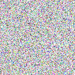
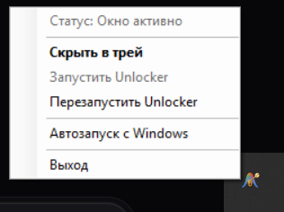
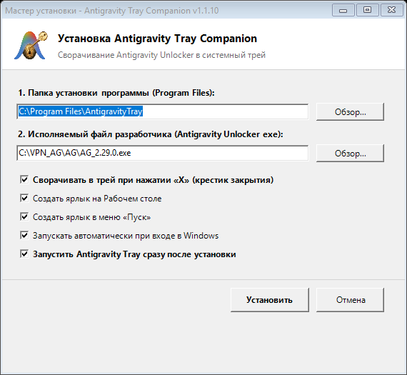

# Antigravity Tray Companion

<p align="center">
  
</p>

<p align="center">
  <strong>Легковесный трей-компаньон, автозапуск с правами Администратора и блокировка случайного закрытия для Antigravity Unlocker</strong>
</p>

<p align="center">
  <a href="https://github.com/gda96/AntigravityTray/releases"></a>
  
  
  
  
</p>

---

## 📖 О проекте

**Antigravity Tray Companion** — это системная утилита для Windows, разработанная специально для пользователей **[Antigravity Unlocker](https://github.com/confeden/Antigravity)** (инструмента разблокировки и обхода ограничений для Google Antigravity / Gemini в санкционных регионах).

Antigravity Unlocker является критически важной фоновой службой для работы с Google Antigravity IDE, однако оригинальный клиент на Rust (`eframe`/`egui`) не имеет встроенной интеграции с системным треем Windows. **Antigravity Tray Companion** превращает Unlocker в незаметную, надёжную и бесперебойную фоновую службу.

<p align="center">
  
</p>

---

## ❓ Какие проблемы решает утилита

### 1. Случайное закрытие окна и выгрузка из оперативной памяти
* **Проблема:** При нажатии на стандартный крестик («X») или случайном нажатии `Alt + F4` окно Unlocker полностью закрывается, а процесс выгружается из оперативной памяти. Из-за этого обрываются все активные соединения, прокси-туннель закрывается, и в Google Antigravity мгновенно появляется **«Ошибка 400 в чате с ИИ»**.
* **Решение:** Antigravity Tray Companion перехватывает клики по кнопке закрытия через низкоуровневые хуки мыши (`WM_LBUTTONDOWN` и `WM_LBUTTONUP`), перехватывает сочетание `Alt + F4` через глобальный низкоуровневый клавиатурный хук (`WH_KEYBOARD_LL`) и отключает системную команду `SC_CLOSE` в системном меню окна. При нажатии на крестик или `Alt + F4` окно **мгновенно и бесшовно прячется в трей**, оставаясь активным в памяти.

### 2. Постоянное сообщение «Служба обхода не работает. Починить»
* **Проблема:** После аварийного или некорректного закрытия Unlocker при повторном запуске требует заново запустить и переустановить внутреннюю системную службу `ag_dns` на порту `53129`. Это приводит к потере времени на повторную диагностику.
* **Решение:** Программа бережно разделяет GUI-оболочку и фоновую системную службу `ag_dns.exe`, гарантируя, что служба никогда не перезагружается без необходимости.

### 3. Автозапуск без назойливых запросов UAC (Контроль учётных записей)
* **Проблема:** Для управления сетевыми правилами и локальным DNS Unlocker требует прав Администратора (`High Integrity Level`). Обычный автозапуск через реестр `Run` в Windows для программ с повышенными привилегиями либо блокируется системой, либо каждый раз показывает раздражающий запрос UAC при включении компьютера.
* **Решение:** Наш установщик регистрирует задачу в **Планировщике заданий Windows (Task Scheduler)** с флагом наивысших прав (`/rl highest`). При входе пользователя в Windows всё запускается моментально и совершенно тихо в фоне.

### 4. Размытый интерфейс на экранах с масштабированием (High-DPI)
* **Проблема:** На дисплеях ноутбуков и 2K/4K мониторах с масштабом 125%, 150% или 175% контекстные меню трея часто становятся нечёткими и мыльными из-за растровой интерполяции Windows DWM.
* **Решение:** Встроенный манифест с директивой `PerMonitorV2` и принудительное включение субпиксельного сглаживания ClearType обеспечивают кристальную резкость шрифтов и иконок.

### 5. Строгая изоляция окон (защита от ложного захвата браузеров)
* **Проблема:** Простые трей-утилиты ищут окно только по подстроке в заголовке, из-за чего при открытии веб-страницы проекта в Яндекс Браузере или Chrome трей мог ошибочно захватить окно браузера.
* **Решение:** Трей производит строгую валидацию процесса (только `ag_*.exe`, класс `Window Class`) и жестко исключает любые веб-браузеры и редакторы. Если Unlocker закрыт, клик по иконке в трее не трогает другие окна, а автоматически перезапускает Unlocker с правами Администратора.

---

## ✨ Ключевые возможности

| Функция | Описание |
| :--- | :--- |
| 🛡️ **Блокировка «Х»** | Клик по крестику окна Unlocker прячет его в трей вместо закрытия. |
| 🚀 **Автозапуск Unlocker** | При старте трея автоматически поднимается Unlocker с правами Администратора и сразу прячется в трей. |
| ⏰ **Бесшовный автозапуск** | Запуск вместе с Windows через Планировщик заданий без всплывающих окон UAC. |
| ⌨️ **Горячая клавиша** | Комбинация `Ctrl + Shift + A` моментально показывает или скрывает окно в любой момент. |
| 📦 **Классический Setup Wizard** | Полноценный инсталлятор в `C:\Program Files\AntigravityTray` с ярлыками и пунктом в «Установке и удалении программ». |
| 🔍 **Автоопределение пути** | Автоматически ищет установленный `AG_*.exe` на дисках и даёт выбрать вручную. |
| 🎨 **High-DPI PerMonitorV2** | Идеальная чёткость шрифтов на мониторах любого разрешения. |
| 🪶 **Нулевой оверхед** | Написан на чистом C# и Win32 API, весит ~130 КБ и потребляет всего 5-8 МБ RAM. |

---

## 📸 Скриншоты

<p align="center">
  &nbsp;&nbsp;&nbsp;&nbsp;
  
</p>

---

## 📥 Быстрая установка

1. Перейдите в раздел **[Релизы (Releases)](https://github.com/gda96/AntigravityTray/releases/latest)**.
2. Скачайте файл установщика **`AntigravityTray_Setup.exe`**.
3. Запустите инсталлятор:
   * Выберите папку установки (по умолчанию: `C:\Program Files\AntigravityTray`).
   * Укажите путь к исполняемому файлу разработчика Unlocker (например, `AG_2.29.0.exe`).
   * Нажмите кнопку **«Установить»**.
4. Готово! В трее появится иконка Antigravity, Unlocker запустится в фоне и будет готов к работе.

> **Портативная версия:** Если вы не хотите устанавливать программу, просто скачайте автономный файл **`AntigravityTray.exe`** из релизов и положите его в удобную папку.

---

## 🛠️ Как это устроено (Под капотом)

### 1. Архитектура перехвата окна (Win32 Hooks)
Unlocker собран на стеке Rust + `eframe` (`egui` + `winit`). Графический тулкит рисует заголовок и кнопку закрытия в неклиентской области или напрямую в клиентской части окна.

Для надёжного перехвата нажатия крестика Antigravity Tray Companion использует двухуровневую защиту:
```csharp
// 1. Отключение команды SC_CLOSE на уровне системного меню Windows
IntPtr hMenu = GetSystemMenu(hWnd, false);
if (hMenu != IntPtr.Zero)
{
    EnableMenuItem(hMenu, SC_CLOSE, MF_BYCOMMAND | MF_DISABLED | MF_GRAYED);
}

// 2. Глобальный хук мыши (WH_MOUSE_LL) с обработкой WM_LBUTTONDOWN и WM_LBUTTONUP
// Предотвращает обработку DWM отпускания клавиши мыши на крестике:
if (nCode >= 0 && (wParam == (IntPtr)WM_LBUTTONDOWN || wParam == (IntPtr)WM_LBUTTONUP))
{
    if (IsInCloseButtonArea(cursorPos, windowRect))
    {
        ShowWindow(targetHwnd, SW_HIDE);
        return (IntPtr)1; // Поглощаем событие клика
    }
}
```

### 2. Защита службы `ag_dns.exe`
При выходе через пункт контекстного меню трея **«Выход»** завершается только графический процесс клиента Unlocker. Системный демон `ag_dns.exe`, слушающий сокет `127.0.0.1:53129`, остаётся нетронутым:
```csharp
if (procName.Equals("ag_dns", StringComparison.OrdinalIgnoreCase))
{
    continue; // Службу обхода не трогаем — исключаем ошибку "Служба обхода не работает"
}
```

### 3. Автозапуск без диалогов UAC
Установщик автоматически создаёт задание в Планировщике Windows через вызов утилиты `schtasks`:
```cmd
schtasks /create /tn "AntigravityTray" /tr "\"C:\Program Files\AntigravityTray\AntigravityTray.exe\"" /sc onlogon /rl highest /f
```

---

## 🔨 Сборка из исходников

Для сборки проекта не требуется установка Visual Studio или тяжеловесных SDK. Используется встроенный в любую Windows 10/11 компилятор `csc.exe` (.NET Framework 4.8).

1. Клонируйте репозиторий:
   ```bash
   git clone https://github.com/gda96/AntigravityTray.git
   cd AntigravityTray
   ```
2. Запустите скрипт сборки:
   * Через командную строку:
     ```cmd
     build.bat
     ```
   * Либо через PowerShell:
     ```powershell
     .\build.ps1
     ```
3. Скомпилированные бинарники появятся прямо в корне проекта:
   * `AntigravityTray.exe`
   * `AntigravityTray_Setup.exe`

---

## ⌨️ Горячие клавиши и управление

* **Левый клик по иконке в трее:** Показать / скрыть окно Unlocker.
* **Правый клик по иконке в трее:** Открыть быстрое меню управления (статус, перезапуск, автозапуск, выход).
* **`Ctrl + Shift + A`:** Глобальная комбинация клавиш для скрытия/отображения окна из любого места.
* **Крестик («X») в окне Unlocker:** Сворачивает окно в трей без остановки процессов.

---

## 📄 Лицензия

Проект распространяется под свободной лицензией **MIT License**. Подробности в файле [LICENSE](LICENSE).

---

## 🙏 Благодарности

* Проекту **[confeden/Antigravity](https://github.com/confeden/Antigravity)** за разработку инструмента разблокировки Google Antigravity.
* Сообществу пользователей Google Antigravity IDE за обратную связь и тестирование.
